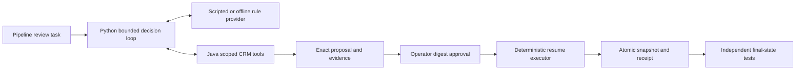

# CRM pipeline agent

A small local workflow for reviewing stale opportunity close dates and inconsistent next steps. Python retrieves CRM evidence and stages an exact patch; Java controls review, record versions, field permissions, atomic state changes, and retry receipts.

**12 October upgrade checkpoint: U1 and U2-A local contracts and U2-B offline evaluation contract accepted by main.** On 24 worker-authored/exposed tasks (48 arm runs), the retained offline controller completed 8/12 development and 5/12 capability tasks correctly; the fixed evidence workflow completed 12/12 in each cohort. Negative paired differences are retained. Review was scripted after label-aware scoring, with zero LLM/Salesforce calls and no human review. Read [the compact case study and operating metrics](docs/u2b-case-study.md) and [aggregate evidence](docs/u2b-offline-summary.json). Live/unseen evaluation, genuine Salesforce, current hosted packaging and full upgrade/publication acceptance remain pending.

**9 October local MVP checkpoint: M1/M2 accepted; authored-v6 final local MVP independently accepted, including documentation and release checks.** The fresh validation-informed comparison completed 192/192 runs: rules matched 96/96 pre-review outcomes and baseline 84/96; both reached 96/96 authorized correct states after label-aware synthetic review. Main independently passed 133 tests, three actual Windows checkpoint conditions, 16 development runs and two README demos, then checked all 192 raw states without importing the repository oracle. The earlier 191/192 failure and 98/192 partial cohort remain unchanged. JVM working sets were absent from integration samples, so combined JVM/Python peak and RAM-cap compliance remain unverified. See [fresh results](docs/m3-monitor2-results.json) and [EVIDENCE.md](EVIDENCE.md). Hosted CI, live model quality and production impact remain unestablished.

The two supported demo journeys are a reviewed correction and rejection of an approval made stale by a concurrent rep edit. Only `close_date` and `next_step` are editable. The normal workflow stops for an operator to enter the exact displayed action digest.

## Quickstart

The 11 October U1 upgrade adds an optional Gateway HTTP adapter and an explicitly authored local-double journey through actual Java tools. Main accepted the Windows 50 ms deadline correction and focused local contracts; original timing assertions are preserved. See [the U1 reproduction and limits](docs/u1-upgrade.md), [read-only Salesforce source contract](docs/u2a-salesforce.md) and [manual offline comparison contract](docs/u2b-evaluation.md). Live inference, genuine Salesforce integration and deployment remain unexecuted. Original v1 evidence and all accepted upgrade manifests are preserved separately.

Prerequisites: Python 3.11 and JDK 17 on PATH. No Maven, pip packages, Docker, model runtime, account, or API key is required. Windows commands explicitly select Python 3.11:

```powershell
py -3.11 tools/bootstrap.py --fetch-deps
py -3.11 tools/build.py
py -3.11 crm.py doctor
py -3.11 crm.py demo --scenario approved-update --provider scripted --scripted-review --out work/demo-approved
py -3.11 crm.py demo --scenario stale-approval --provider scripted --scripted-review --out work/demo-stale
py -3.11 tools/check.py --suite m1
```

The dependency lock pins Gson 2.14.0 and its declared Error Prone annotations 2.48.0 dependency. Explicit --fetch-deps provisioning verifies downloaded JAR hashes, published artifact/parent POM declarations and upstream license texts. [The completed audit](docs/dependency-audit.json) records the exact closure and notice findings. Both JARs are on the compile/runtime classpath; no Error Prone compiler or checker is installed. Build/demo/test never download dependencies implicitly. With both original pinned JARs already present, use `py -3.11 tools/bootstrap.py --cached-only`: it checks both exact pins without a network/audit/ledger access or fetch fallback. Fetch mode records received response-body bytes durably and limits cumulative transfers to 2 MiB per bootstrap accounting scope; HTTP headers are excluded.

Main's 12 October cached-copy run passed steps 1–8: cached bootstrap, build, doctor, both demos, M1, Salesforce local contracts and the Gateway double. The source checker then failed at step 9 because its file-path CLI could not import evaluation; release step 10 did not run. The bounded import correction adds the checker’s own source root and an actual isolated-source subprocess regression. [The packaging guide](docs/quickstart.md) now separates those unchanged passing native steps from the remaining source/release gates. Full packaging acceptance remains with main; no native journey or cohort rerun is requested.

Choose a new output directory for each demo; existing outputs are preserved. Observed approved result: close date `2026-11-12`, next step `Send revised agreement by 2026-10-09.`, version `7 -> 8`, one apply event, and the original receipt on retry. Observed stale result: the rep's concurrent next step remains, version is 8, and there are zero agent apply events. The tests read committed state directly to check these outcomes.

## Manual review

```powershell
py -3.11 crm.py init --fixture fixtures/dev/approved-update.json --store work/manual-crm
py -3.11 crm.py run --store work/manual-crm --provider scripted --scope north --as-of 2026-10-08 --out work/manual-run
py -3.11 crm.py review --store work/manual-crm --proposal latest
py -3.11 crm.py approve --store work/manual-crm --proposal latest --reviewer manager-north --interactive
py -3.11 crm.py resume --store work/manual-crm --run work/manual-run
py -3.11 crm.py inspect --store work/manual-crm
```

`latest` resolves once to a concrete proposal. Approval requires entering its exact displayed digest. `reject` uses the same explicit review flow. Resume applies only the immutable stored patch; no replacement patch comes from the provider. Repeated resume reuses its checkpointed apply key. `inspect` is a trusted local fixture-operator view.

M2 also supports `--provider offline-rules`, and `py -3.11 crm.py cancel --run work/manual-run`. Review CLI actions persist their exact key/arguments in an immutable `operator-intent-*.json` file before approve/reject dispatch. Resume queries the original committed operation before retrying an uncertain mutation. Cancellation blocks new writes; a possibly committed write remains uncertain until reconciliation. The M1 regression and M2 policy/recovery tests exercised these boundaries.

## Architecture and contribution



The provider chooses tools from observed records. It cannot approve, execute shell commands, read arbitrary files, or write CRM fields directly. Each Java request is a bounded JSON subprocess. Gson 2.14.0 and Error Prone annotations 2.48.0 are the two verified Java libraries. The store commits full immutable generations under a persistent file lock; state, receipt, approval consumption, and audit apply event share one commit. Store caps are 500 generations, 10 MiB per snapshot, and 100 MiB total generated storage.

The contribution is an inspectable CRM-specific governed update contract with evidence and concurrent-edit outcomes. Generic approval workflows and CRM CRUD are established prior art. [Architecture](docs/architecture.md), [local trust boundaries](docs/threat-model.md), and [protocol](contracts/protocol.md) explain the design.

## Verification and limits

The current source/aggregate evidence can be reviewed without Java, accounts or network:

```powershell
py -3.11 -m unittest tests.test_u2b_summary tests.test_upgrade_provenance -v
py -3.11 -m tools.check_current_upgrade
py -3.11 -m tools.release
```

These commands validate summary/redaction contracts and versioned source/data provenance. CI includes the new pure baseline/evaluator/summary coverage alongside retained deadline/domain/provider suites. The expensive cohort comparison remains explicit/manual, with fresh outputs and an assigned runtime envelope; it is not part of automatic CI.

```powershell
py -3.11 tools/check.py --suite light
py -3.11 tools/check.py --suite m1
py -3.11 tools/check.py --suite m2-unit
py -3.11 tools/check.py --suite m3-unit
py -3.11 tools/check.py --suite release
```

`light` runs Python protocol/loop tests without Java or networking. `m1` requires the built Java classes and both verified dependency artifacts; it runs parser assertions, real Java integration tests, and both demos. The integration verifier reads committed JSON state directly. It also exercises exact interactive approval input and two separately approved proposals against the same record version; only the first proposal applies.

`m2-unit` runs 50 pure-Python components against in-memory doubles. `m3-unit` adds evaluator/accounting/corruption and source-export controls on tiny invented data without a model, Java or case-set execution. `release` statically checks source/license/pins/path hygiene and frozen hashes without a JDK or Git. The `policy`, `recovery`, and `provider` suites require rebuilt Java and/or an actual local HTTP test server; all passed at M2. The authored-v5 `all` suite passed 119 methods, including both demos. The authored-v6 candidate adds 14 persistence/recovery methods; all 133 methods passed before the later held-out resource stop. [M2 details](docs/m2.md), [the frozen M3 contract](docs/evaluation.md), [original contribution](docs/originality.md) and [clean-copy procedure](docs/quickstart.md) distinguish measured evidence from pending independent acceptance and hosted CI. [M3 outcomes](docs/m3.md) report pre-review proposals separately from the synthetic reviewer's final-state outcomes.

The accepted M1 supports one authored fictional opportunity and its note. A quote/hash proves provenance, not the truth or meaning of a sales commitment. Local launcher roles assume a trusted machine owner and provide no enterprise authentication or OS isolation. Snapshot storage is intended for small demos. Portable power-loss durability and network filesystems are unverified. The optional Ollama transport requires explicit opt-in, a literal loopback address and an already installed local model; no service, model or paid call has been executed.

Code/documentation: Apache-2.0. Authored fictional fixtures: CC0-1.0. See [third-party notices](THIRD_PARTY_NOTICES.md) and [data license](DATA_LICENSE).
